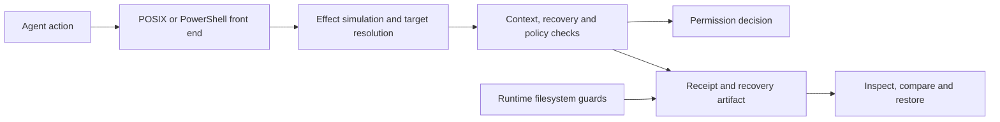

# demo_cli

**A security layer for AI coding agents: understand the action, preserve what it can destroy, and record the decision.**

Developed at **WePwn** · **In development** · Python · Linux / Windows

demo_cli checks shell commands and file changes before execution. It models their
potential effects, captures supported local recovery targets and returns a
permission decision to the agent host. When a supported change goes wrong, the
captured state can be inspected and restored.

The engineering focus is **recoverability backed by an actual snapshot**:
classifying an action as recoverable is only useful when the affected data has
been successfully preserved. Unsupported effects and incomplete coverage are
surfaced through the policy and review paths.

[Demonstration](#demonstration) · [Engineering highlights](#engineering-highlights) · [Architecture](#architecture) · [Development setup](#development-setup) · [Technical reference](docs/reference.md)

## Demonstration


The recorded demonstration shows a recovery point captured before deletion,
followed by restoration through `demo_cli undo`. The receipt connects the action,
policy decision and recovery artifact for later inspection.

## Engineering highlights

| Area | Implementation | Why it matters |
|---|---|---|
| **Command effect analysis** | POSIX and PowerShell front ends feed a shared effect model and virtual filesystem simulation. | Tracks what existing data a sequence may destroy, including moves, overwrites and nested shell operations. |
| **Recovery coverage** | Resolve affected targets, capture supported files/directories/databases, and reject incomplete recovery sets. | A partial backup must not be presented as coverage for the whole action. |
| **Runtime interception** | Linux syscall tracing and a Windows WinFsp filesystem layer complement command analysis. | Observe filesystem operations that are hidden behind scripts or indirection. |
| **Decision provenance** | Hash-chained receipts record context, rationale, recovery points and the decision path. | Makes a decision inspectable and connects it to the evidence needed for recovery. |
| **Cross-platform semantics** | PowerShell parameter binding uses generated cmdlet metadata; platform adapters share policy and recovery logic. | Handles aliases, parameter positions and abbreviated flags without duplicating the policy engine. |
| **Failure-oriented testing** | Regression scenarios cover broken symlinks, capture limits, receipt integrity and errors reaching the user. | Tests the conditions in which protection could silently disappear or overstate its coverage. |

### Follow the data through the command

For a sequence such as `mv source.txt staged.txt && rm staged.txt`, the name being
deleted differs from the original data’s location. The simulator tracks content
origins through a virtual filesystem overlay, so the impact assessment can account
for that relationship. Simulation reads filesystem metadata; it does not execute
the command being analyzed.

See [the simulator](src/demo_cli/engine/simulate.py) and
[PowerShell parameter binding](src/demo_cli/engine/ps_bind.py).

### Preserve the target before allowing the change

Recovery supports files, directories, SQLite and PostgreSQL targets. Capture
checks include project boundaries, symlink handling, storage limits and whether
all required targets were preserved. Remote effects are classified separately;
a local snapshot cannot reverse an action on another service.

See [recovery](src/demo_cli/recovery.py),
[effect assessment](src/demo_cli/engine/verdict.py) and
[policy decisions](src/demo_cli/decide.py).

## Architecture



Host adapters are implemented for Claude Code, Cursor and Codex. Coverage depends
on the host, enabled layers and platform; Codex on Windows remains documented as
untested.

| Layer | Linux | Windows |
|---|---|---|
| Command analysis | Agent hooks | Agent hooks |
| Interactive shell capture | Bash `DEBUG` trap | No equivalent implemented |
| Filesystem interception | `ptrace`, through `demo_cli run` | WinFsp-backed filesystem guard |
| Optional HTTP egress filtering | mitmproxy addon | mitmproxy addon |

Installing a command hook does not activate every layer. The Linux runtime guard
is an x86-64 tracing prototype; Windows filesystem protection requires WinFsp and
its backing-directory setup. Platform prerequisites and lifecycle operations are
covered in the [technical reference](docs/reference.md).

## Development setup

Requires Python 3.9+ and pipx. These commands install the checked-out development
revision locally:

```bash
git clone https://github.com/nizaryart/DEMO_LOADING.git
cd DEMO_LOADING
pipx install -e .
demo_cli --version
```

Inside a disposable project, enable the Claude Code command hook in shadow mode:

```bash
demo_cli init --mode shadow
demo_cli install-hook --claude
demo_cli doctor
demo_cli status
```

| Mode | Behavior |
|---|---|
| `shadow` | Evaluate, capture eligible recovery targets and record decisions without enforcing blocks. |
| `enforce` | Apply the policy’s permission and review decisions. |

To evaluate command text without executing that command:

```bash
demo_cli check "rm -rf dist/" --mode shadow --json
```

After an action with a captured recovery point:

```bash
demo_cli log
demo_cli diff <id>
demo_cli undo <id>
demo_cli verify
```

Use an identifier from `log`. Directory recovery restores the captured directory
state, including reverting subsequent changes inside it; inspect the diff before
restoring. An action without a captured recovery point cannot be undone by this
workflow.

## Validation

```bash
python -m pip install -e ".[dev]"
python -m pytest -q
```

The [test suite](tests/) covers effect modeling, recovery, host adapters,
configuration, receipt verification and platform behavior. Examples of security
regression work include:

- [Broken symlinks and snapshot boundaries](tests/test_symlink_snapshot.py).
- [Capture refusals reaching the user](tests/test_cap_refusal_reaches_the_person.py).
- [Protecting the receipt chain from redirection](tests/test_redirect_does_not_wipe_the_chain.py).
- [Database target and effect handling](tests/test_engine_c2a.py).

Test results depend on the checkout, operating system and available runtime
components. Windows driver behavior requires validation on Windows.

## Security model and limits

The intended use is reducing accidental damage by cooperative coding agents.
Protection depends on enabled host hooks, available runtime guards and their
configured scope. The implementation has modeled command coverage and fallback
paths; it is not a complete implementation of either shell language. Shadow mode
is non-enforcing, and some internal adapter errors deliberately fail open.

Receipt hashing exposes inconsistent edits, but an unkeyed chain does not prove
who wrote a receipt or prevent a consistent rewrite by someone with write access.
Retaining a head hash externally supports later comparison. See
[receipt guarantees](docs/reference.md#what-the-receipt-chain-proves) and
[known issues](docs/reference.md#known-issues-beta).

## Project context and license

Developed in the context of Nizar Yartaoui’s application security work at
**WePwn**. The repository presents the implementation and engineering work while
the project remains in development.

Copyright © 2026 WePwn. MIT — see [LICENSE](LICENSE) and
[package metadata](pyproject.toml).
